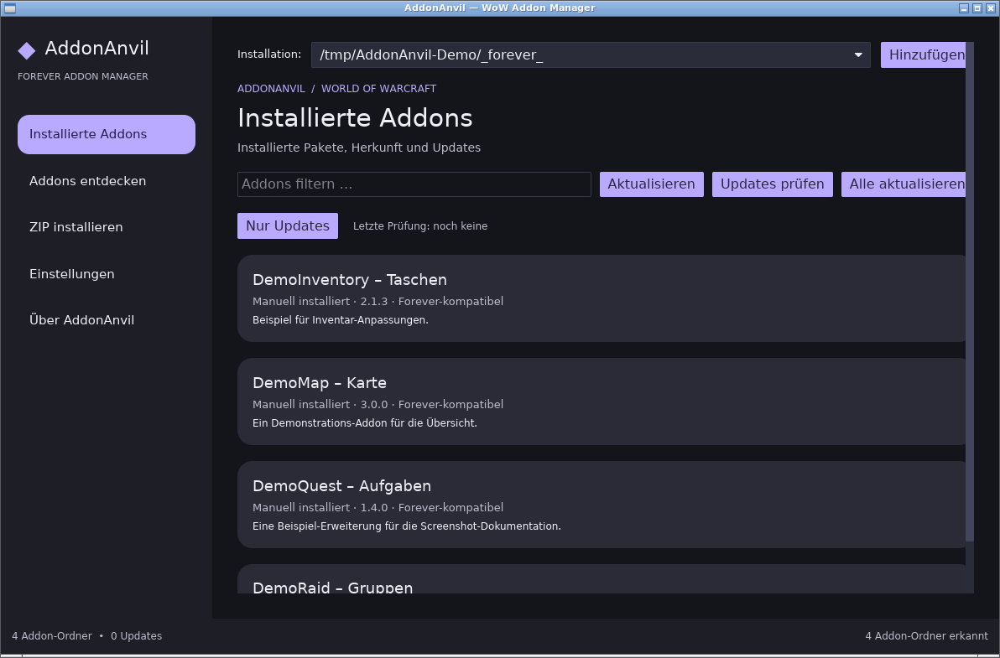
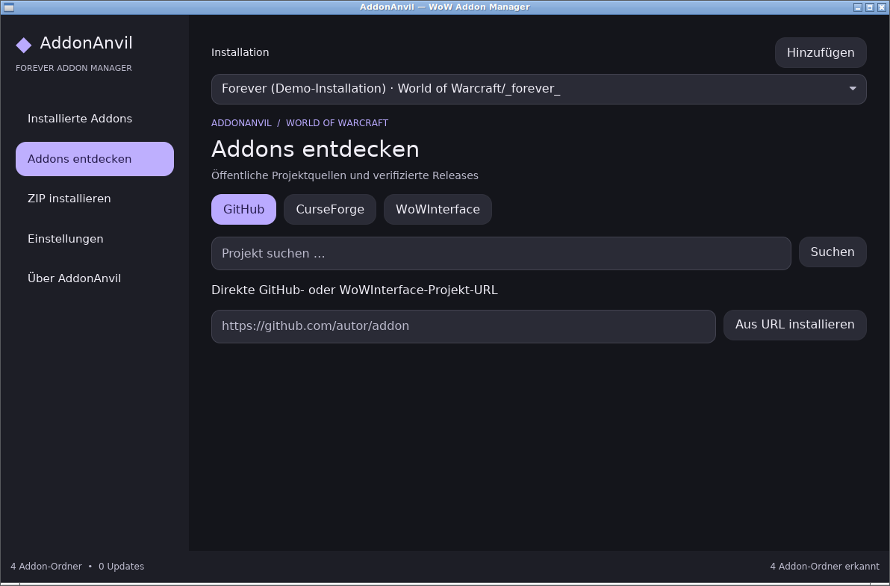
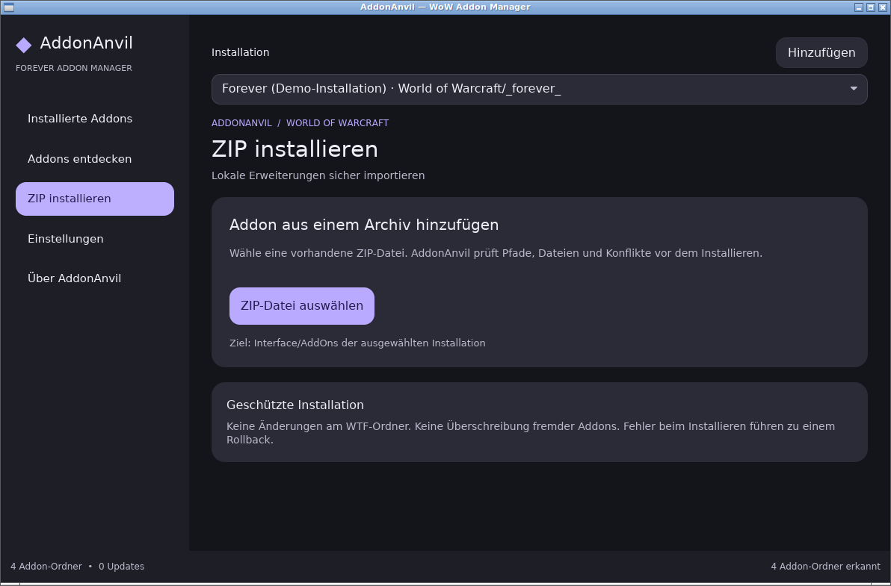
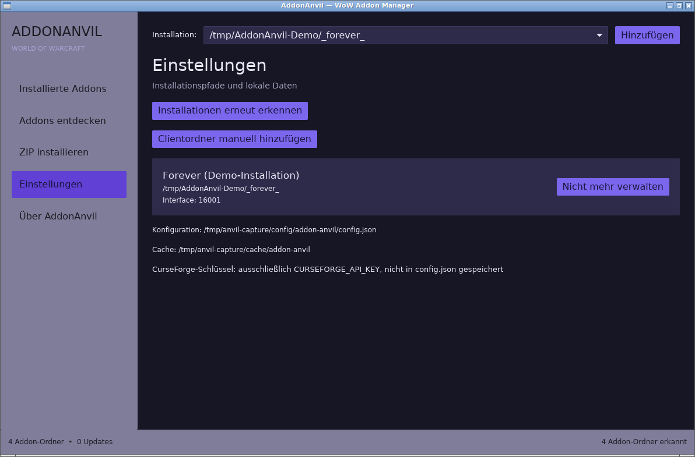
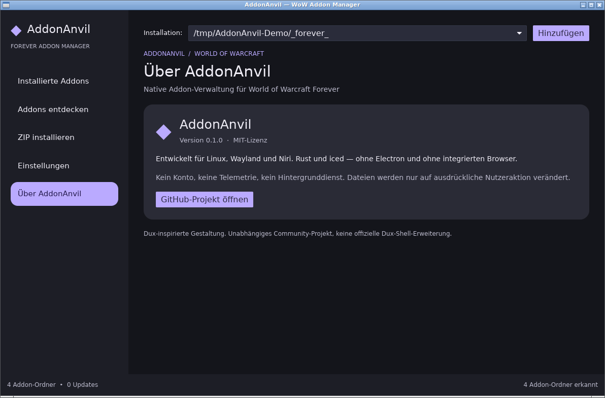

# AddonAnvil

Native Rust/iced addon manager for World of Warcraft **Forever** on Linux (Wayland, Niri, Wine/Lutris/Proton). Dux Shell-inspired interface with optional matugen color integration; **no Dux runtime requirement**. No Electron, login, daemon, telemetry or ads.

> **Development status:** CI-verified Linux build (format, Clippy, 26 tests and release binary). Real Wayland/Niri and provider end-to-end testing remain outstanding.

## Screenshots

Original screenshots captured from the running AddonAnvil 0.1.0 iced binary in a virtual Linux X11 session (Xvfb/Openbox). The client and addon names are **synthetic demo data**, not a real user installation. These captures do not verify Wayland/Niri support.

| Installed addons | Discover addons |
| --- | --- |
|  |  |
| Local ZIP installation | Settings |
|  |  |
| About AddonAnvil | |
|  | |

## Features

- Detect likely Wine/Lutris/Proton Forever installations and add custom client directories.
- Switch between several installations; recognize _forever_ and older _classic_beta_.
- Read .toc metadata, including multiple interface numbers and _Forever/_Camelot variants.
- Show existing manual addons without silently taking ownership of their files.
- Import local ZIPs offline; reject unsafe paths, symlinks, oversized archives and collisions.
- Install, update and uninstall as folder groups with an error rollback; preserve the WTF directory.
- GitHub: repository search, direct project URLs and published ZIP releases.
- CurseForge: optional user-provided API key, dynamic Forever type, authorized file downloads.
- WoWInterface: direct URLs and public metadata where available.
- Asynchronous online searches, update checks, single and batch updates.
- Native German UI with Dux-inspired semantic surfaces, cards and navigation; optional auto-refreshing matugen color palette. No embedded browser.

**Important limitations:** Full-text WoWInterface Forever search is not claimed. Manual folders cannot yet be linked to a provider. Download progress is reported by stage, not byte percentage. Some provider endpoints must be verified with a working credential/network. Managed folders include SHA-256 fingerprints to detect external changes and block unsafe updates/removal (see docs/security.md).

## Optional Dux Shell colors

AddonAnvil is an **independent** iced application, not a QML plugin. By default it uses a bundled dark palette; it optionally reads `~/.config/addon-anvil/colors.json` (or `$XDG_CONFIG_HOME/addon-anvil/colors.json`). If the file is missing, invalid, or too large, it falls back safely. Theme colors refresh approximately every five seconds.

To generate matching colors with Dux Shell/matugen:

1. Copy `packaging/matugen/addon-anvil.json` to `~/.config/matugen/templates/addon-anvil.json`.
2. Add an entry to `~/.config/matugen/config.toml` under `[config]` (replace USER with your Linux user):

   ```toml
   [templates.addon_anvil]
   input_path = '/home/USER/.config/matugen/templates/addon-anvil.json'
   output_path = '/home/USER/.config/addon-anvil/colors.json'
   ```

3. Change your Dux wallpaper or theme to regenerate colors. Ensure `~/.config/addon-anvil/` exists before matugen writes the file.

Full guidance and source links: [Dux-inspired design system](docs/design-system.md).

## CachyOS / Arch build

Install native prerequisites and stable Rust:

    sudo pacman -S --needed base-devel rustup pkgconf wayland libxkbcommon
    rustup toolchain install stable
    rustup default stable

Clone and run:

    git clone https://github.com/almighty-atlas/addon-anvil.git
    cd addon-anvil
    cargo run --release

For the unmerged implementation, check out the feature branch instead of main:

    git switch feat/native-iced-addon-manager
    cargo run --release

Direct execution after building:

    ./target/release/addon-anvil

Current-user install (no root):

    bash packaging/install-user.sh

Current-user removal, preserving app settings:

    bash packaging/uninstall-user.sh

An experimental Arch PKGBUILD is under packaging; run makepkg there after verifying the source revision.

## Use

1. On first launch, choose the Forever client folder, normally World of Warcraft/_forever_, or choose the parent World of Warcraft directory; the app validates it.
2. The **Installierte Addons** view reads any existing AddOns contents. Unknown origins stay read-only.
3. Use **ZIP installieren** to select a local ZIP, or **Addons entdecken** to search GitHub/CurseForge.
4. In **Addons entdecken**, a GitHub or WoWInterface project page may be pasted to install its eligible release.
5. Click **Updates prüfen** to check supported managed providers, and **Alle aktualisieren** to install discovered updates.

Close WoW before changing files. An open WoW process blocks installation or removal.

## Providers

| Provider | Search | Direct project URL | Updates | Access |
| --- | --- | --- | --- | --- |
| GitHub | Repository search | Yes | Published release ZIPs | Public rate limits |
| WoWInterface | Not verified for Forever | Yes | Public API where available | Anonymous |
| CurseForge | Forever via official API | Via search | Authorized files | Your API key |
| Local ZIP | Offline file picker | n/a | No automatic updates | None |

CurseForge requires a key granted for legitimate third-party use by the official developer program. Supply it through the environment, never through a configuration file:

    export CURSEFORGE_API_KEY='your-approved-key'
    cargo run --release

If the API is inaccessible, does not list Forever, or restricts file distribution, the provider fails closed. AddonAnvil does not scrape or bypass downloads.

## Local state

- Config: XDG_CONFIG_HOME/addon-anvil/config.json (default ~/.config/addon-anvil/config.json)
- Data: XDG_DATA_HOME/addon-anvil (default ~/.local/share/addon-anvil)
- Cache: XDG_CACHE_HOME/addon-anvil (default ~/.cache/addon-anvil)

JSON writes are atomic and schema-versioned. Invalid configuration prevents writes rather than overwriting the original. Archives are unpacked into a temporary directory on the same filesystem. Prior addon directories are backed up until the metadata write completes. The application never modifies saved variables under WTF.

Unexpected power loss can leave hidden .addon-anvil-stage-* backup directories in Interface/AddOns. Inspect them before deleting them.

## Development and tests

    cargo fmt --all -- --check
    cargo clippy --all-targets -- -D warnings
    cargo test
    cargo build --release

Tests use temporary local fixtures, do not touch a real game installation and need no personal API key. CI runs in a headless GitHub Actions Linux runner. The GUI must still be launched and visually inspected under Wayland before release.

Docs: [Architecture](docs/architecture.md), [Providers](docs/providers.md), [Security](docs/security.md), [Design System](docs/design-system.md).

The implementation is original; references include iced, Warcraft Wiki TOC format, CurseForge API, AddonForge and Lightforge. MIT license (LICENSE).
